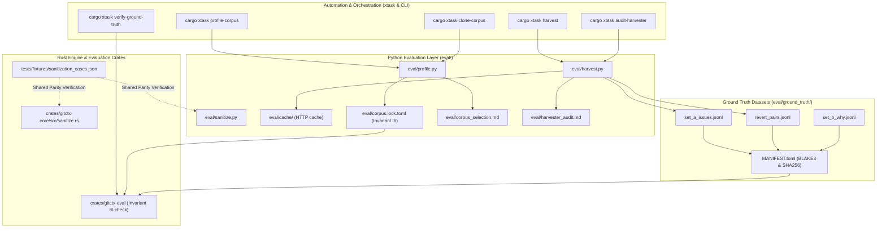
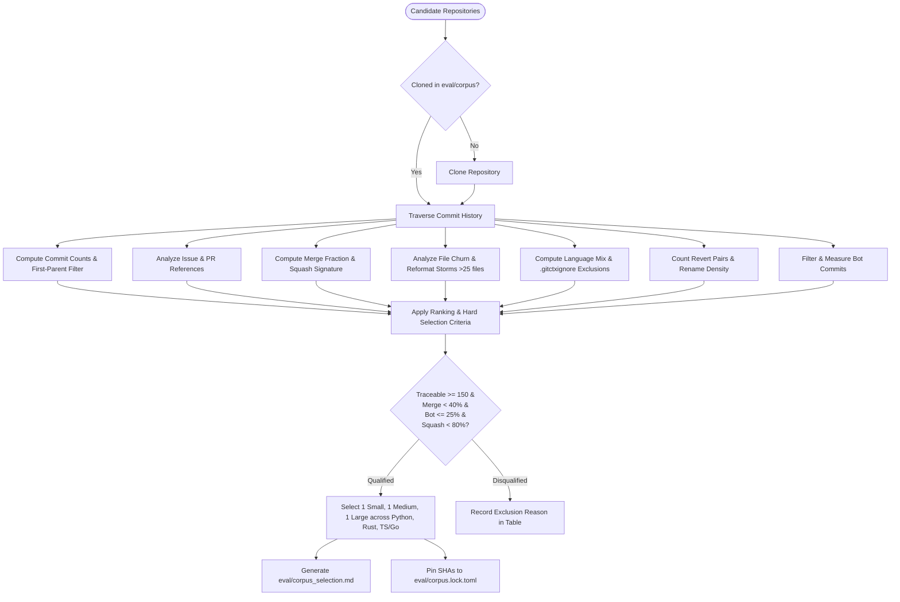
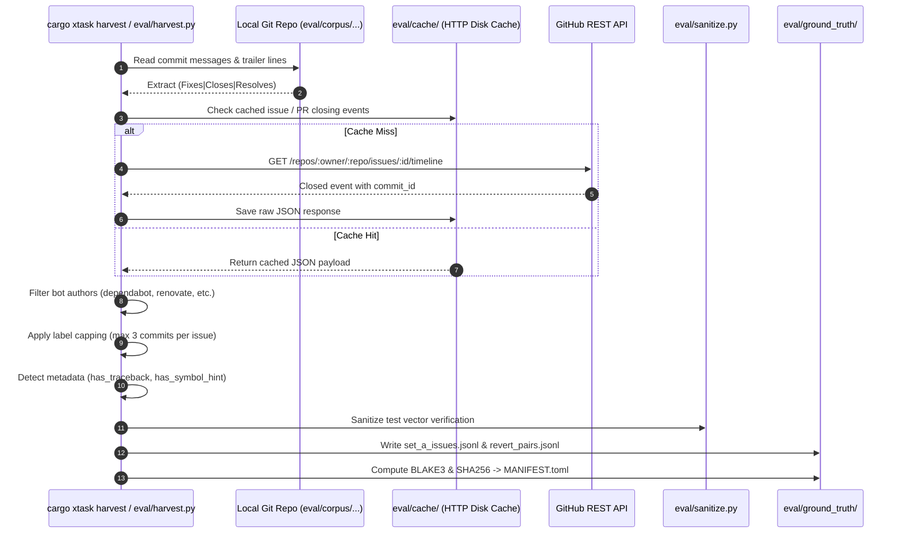
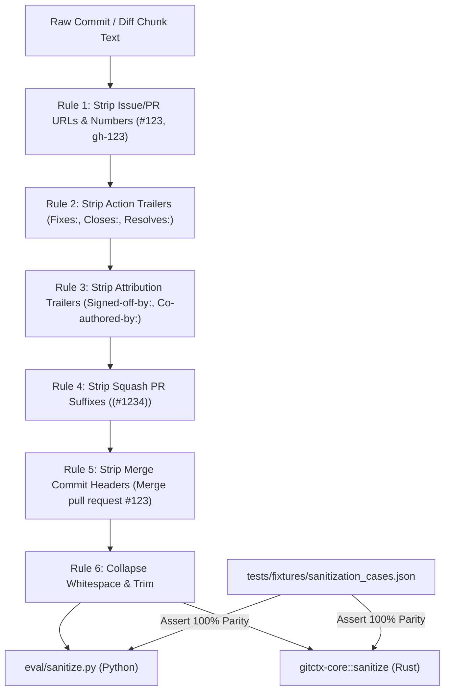
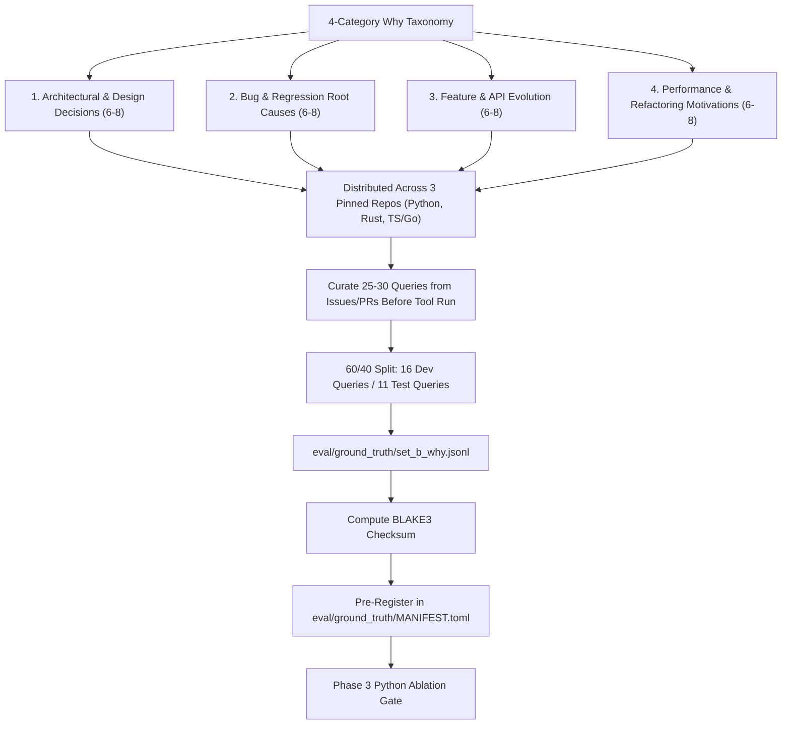

# Phase 2: Corpus Selection, Ground Truth Harvesting & Leakage Sanitization - Research

**Phase:** 02 - Corpus Selection, Ground Truth Harvesting & Leakage Sanitization  
**Status:** Completed  
**Author:** GSD Research Agent  
**Date:** 2026-08-16  

---

## Executive Summary & Recommendation

Phase 2 establishes the empirical foundation upon which all downstream retrieval evaluation, thesis validation (Phase 3 Python ablation), and Rust engine verification (Phases 4–11) depend. If the evaluation corpus is unrepresentative, if ground truth labels are noisy, if queries are tuned post-hoc, or if indexed chunks leak issue numbers/PR trailers, all subsequent recall numbers become scientifically invalid.

This research establishes:
1. **Automated Repository Profiling (`eval/profile.py` / `cargo xtask profile-corpus`)**: A multi-language scanner computing 11 structural metrics across a curated 15-candidate suite spanning Python, Rust, and TypeScript/Go. It enforces pre-registered selection gates ($\ge 150$ traceable closed issues, $<40\%$ merge commit fraction, $\le 25\%$ bot commits, non-universal squash merges) to select a balanced triad: 1 Small (~2k commits), 1 Medium (~10–15k commits), and 1 Large (~30–50k+ commits).
2. **Corpus Pinning & Invariant I6 (`eval/corpus.lock.toml`)**: Cryptographic commit SHA locking ensuring all downstream evaluation harnesses reject unpinned or drifting repositories.
3. **Ground Truth Harvesting Pipeline (`eval/harvest.py` / `cargo xtask harvest`)**: A dual-source extractor combining GitHub API issue-closing events with local commit trailer parsing and revert pairs (`git log --grep '^Revert "'`), filtered against bot authors and capped at $\le 3$ commits per issue.
4. **Harvester Precision Audit CLI (`python eval/harvest.py --audit 30` / `cargo xtask audit-harvester`)**: An interactive terminal inspection tool logging human judgments to `eval/harvester_audit.md` and computing precision with 95% Wilson Score confidence intervals, gated at $p \ge 0.85$.
5. **Cross-Language Leakage Sanitization Parity (`eval/sanitize.py` & `crates/gitctx-core/src/sanitize.rs`)**: A dual-engine implementation validated against shared test vectors in `tests/fixtures/sanitization_cases.json`, stripping issue numbers (`#\d+`, `gh-\d+`), URLs, action trailers (`Fixes`, `Closes`, `Resolves`), attribution trailers (`Signed-off-by`, `Co-authored-by`), squash suffixes (`(#\d+)`), and merge headers from indexed `chunk_text` while preserving `raw_message` in SQLite.
6. **Set B Why-Query Pre-Registration (`eval/ground_truth/set_b_why.jsonl` & `MANIFEST.toml`)**: A hand-curated dataset of 25–30 why-shaped queries across 4 categories (architectural decisions, bug root causes, API evolution, performance motivations) with 60/40 dev/test splits, locked via BLAKE3 checksums prior to Phase 3 ablation execution.

---

## <user_constraints>

The following constraints are transcribed verbatim from `02-CONTEXT.md`:

### Repository Profiling & Selection Mix
- **D-01:** Preset candidate suite of 15 multi-language repositories spanning Python (`psf/requests`, `pallets/flask`, `tiangolo/fastapi`, `pydantic/pydantic`, `encode/httpx`), Rust (`BurntSushi/ripgrep`, `sharkdp/fd`, `tokio-rs/tokio`, `clap-rs/clap`, `actix/actix-web`), and TS/Go (`expressjs/express`, `trpc/trpc`, `gin-gonic/gin`, `spf13/cobra`, `cli/cli`). — **Reversibility:** costly — defines candidate scanning dataset and profiler input coverage.
- **D-02:** Automated ranking with human sign-off: Profiler ranks candidates against hard criteria ($\ge 150$ traceable issues, $<40\%$ merge fraction, $\le 25\%$ bot commits), selecting 1 Small (~2k commits), 1 Medium (~10-15k commits), 1 Large (~30-50k+ commits) across languages (Python, Rust, TS/Go), producing `eval/corpus_selection.md` and locking exact commit SHAs into `eval/corpus.lock.toml`. — **Reversibility:** one-way — evaluation corpus SHAs form the immutable ground truth for all downstream benchmarks (Invariant I6).
- **D-03:** Pinned repositories cloned into dedicated `eval/corpus/<owner>__<repo>` via `cargo xtask clone-corpus` and `eval/profile.py`, with hard SHA checkout verification where evaluation runners refuse to execute unless HEAD matches `eval/corpus.lock.toml`. — **Reversibility:** costly — directory layout and invariant enforcement contract.
- **D-04:** Standard `.gitctxignore` with built-in defaults filtering vendored/generated files (`node_modules`, `vendor/`, `*_pb2.py`, lockfiles, minified assets), excluding known bot authors (`dependabot[bot]`, `renovate[bot]`, `pre-commit-ci[bot]`), and logging exclusion fractions in `eval/corpus_selection.md`. — **Reversibility:** reversible.

### Ground Truth Harvesting Architecture
- **D-05:** Standalone Python harvester script (`eval/harvest.py`) leveraging `reference_repos/pydriller` for commit/trailer mining and GitHub REST API (offline cached in `eval/cache/`) with a `cargo xtask harvest` wrapper. — **Reversibility:** costly — harvester pipeline produces all evaluation datasets.
- **D-06:** Dual extraction with label capping: Combine commit message/merge body trailer regexes (`(Fixes|Closes|Resolves|Ref) #N`) with GitHub ClosingEvent API, extract revert pairs (`git log --grep '^Revert "'`), filter bots, and cap at max 3 commits per issue (confidence: `close_event` > `explicit_trailer` > `ref`). — **Reversibility:** one-way — query-label ground truth pairs for Set A and reverts.
- **D-07:** Interactive precision audit CLI (`python eval/harvest.py --audit 30` / `cargo xtask audit-harvester`) displaying issue query vs commit diff, logging judgements (`VALID`/`INVALID`/`NOISY`) to `eval/harvester_audit.md`, and computing precision + 95% Wilson CI (gated at $\ge 0.85$). — **Reversibility:** reversible.
- **D-08:** Canonical JSONL dataset schemas (`eval/ground_truth/set_a_issues.jsonl`, `eval/ground_truth/revert_pairs.jsonl`) with BLAKE3 / SHA256 integrity checksums locked in `eval/ground_truth/MANIFEST.toml`. — **Reversibility:** one-way — schema consumed by Phase 3 ablation and all future evaluation harnesses.

### Leakage Sanitization Pipeline
- **D-09:** Dual implementation with shared test suite: `eval/sanitize.py` for Python evaluation & `crates/gitctx-core/src/sanitize.rs` in Rust, verified against identical test cases in `tests/fixtures/sanitization_cases.json` to ensure 100% stripping parity across Python and Rust. — **Reversibility:** costly — core leakage contract across both languages.
- **D-10:** Comprehensive sanitization rules: Strip issue/PR numbers (`#\d+`, `gh-\d+`), issue/PR URLs, action trailers (`Fixes`, `Closes`, `Resolves`), attribution trailers (`Signed-off-by`, `Co-authored-by`, `Reviewed-by`), squash PR suffixes (`(#\d+)`), and merge commit header boilerplate from indexed chunk text. — **Reversibility:** one-way — defines indexable chunk text representation and prevents synthetic high-recall artifacts.
- **D-11:** Store raw original message in `commits.raw_message` (for human UI display) and sanitized text in `chunks.chunk_text` (for Tantivy and vector embeddings), logging `strip_count` and modified flags in metadata/audit logs. — **Reversibility:** costly — database schema and chunk pipeline design.
- **D-12:** Preserve natural query text (do not strip stack traces from user/issue queries), but tag queries with boolean metadata flags (`has_traceback`, `has_symbol_hint`) in JSONL to enable stratified ablation reporting (symbol-present vs conceptual). — **Reversibility:** reversible.

### Set B Why-Query Curation Protocol
- **D-13:** Balanced 4-category taxonomy: Author 25-30 why-shaped queries covering: (1) Architectural / Design decisions, (2) Bug / Regression root causes, (3) Feature / API evolution, and (4) Performance / Refactoring motivations. — **Reversibility:** reversible.
- **D-14:** Rich provenance JSONL schema: Record `qid`, `repo`, `query_set: "B"`, `category`, `query`, `discussion_source` (issue/PR URL), `gold_commits` (with confidence), `gold_rationale` (why this commit answers it), `split` (`dev`/`test`), and `curator_date` in `eval/ground_truth/set_b_why.jsonl`. — **Reversibility:** one-way — evaluation schema for non-circular why retrieval evaluation.
- **D-15:** Commit all Set B queries and rationale into `eval/ground_truth/set_b_why.jsonl` with BLAKE3 hash recorded in `eval/ground_truth/MANIFEST.toml` during Phase 2 before Phase 3 Python ablation begins, preventing post-hoc query tuning. — **Reversibility:** one-way — scientific pre-registration integrity guarantee.
- **D-16:** Balanced multi-repo distribution (8-10 queries per locked repo across Python, Rust, and TS/Go) with a 60/40 Dev/Test split tagged in metadata. — **Reversibility:** reversible.

### the agent's Discretion
- Exact CLI flags and terminal output formatting for `eval/profile.py`, `eval/harvest.py`, and `eval/sanitize.py`.
- Internal helper structure for GitHub REST API rate-limit handling and disk caching in `eval/cache/`.

---

## <phase_requirements>

| Requirement ID | Description | Phase 2 Research Mapping | Verification Mechanism |
|---|---|---|---|
| **CORP-01** | Scripted multi-language repository analyzer computing traceable issue densities, merge fractions, churn, and rename density across diverse languages (Python, Rust, TypeScript/JavaScript, Go, etc.). | Implemented in `eval/profile.py` with `cargo xtask profile-corpus`. Analyzes 15 candidate repositories across 11 metrics. | Profiler runs on candidate suite, generates `eval/corpus_selection.md`, and runs against synthetic fixture repositories in `tests/fixtures/mkrepo.rs`. |
| **CORP-02** | Pinned evaluation corpus locked by exact commit SHAs in `eval/corpus.lock.toml` (Invariant I6). | Defined TOML schema locking URL, commit SHA, harvest date, language, and size tier for $\ge 3$ repositories. Enforced by `gitctx-eval::assert_corpus_locked_sha`. | `cargo xtask test-invariants` verifies HEAD SHA matches lockfile; evaluation runners hard-fail on mismatch. |
| **CORP-03** | Ground truth harvester (`eval/harvest.py`) extracting issue-closing commits (Set A) and revert pairs with manual audit measuring harvester precision. | Implemented in `eval/harvest.py` / `cargo xtask harvest`. Combines GitHub API + trailer regex + revert parser. Includes CLI audit tool computing Wilson CI. | `python eval/harvest.py --audit 30` produces `eval/harvester_audit.md` with precision $\ge 0.85$ (95% CI). Schema checked by Nyquist test. |
| **CORP-04** | Leakage sanitization pipeline stripping issue numbers, PR trailers (`Fixes #N`, `Closes #N`), URLs, and squash prefixes from indexed chunk text. | Dual engine: `eval/sanitize.py` (Python) and `crates/gitctx-core/src/sanitize.rs` (Rust). 100% parity verified via `tests/fixtures/sanitization_cases.json`. | Cross-language test runner asserts identical sanitized text and strip counts on $\ge 20$ edge cases. |
| **CORP-05** | Hand-authored why-shaped evaluation set (Set B, 25-30 queries) curated from issue/PR discussions prior to inspection of tool outputs. | Pre-registered in `eval/ground_truth/set_b_why.jsonl` across 4 categories (8–10 queries per repo, 60/40 split) with BLAKE3 checksums locked in `MANIFEST.toml`. | `eval/ground_truth/MANIFEST.toml` validation test confirms byte hash before Phase 3 Python ablation runs. |

---

## Architectural Responsibility Map



### Component Responsibilities

1. **`eval/profile.py` / `cargo xtask profile-corpus`**:
   - Iterates through 15 candidate repositories (Python, Rust, TS/Go).
   - Computes commit counts, merge fractions, issue reference density, file churn statistics, rename density, and bot author fractions.
   - Evaluates hard criteria ($N_{traceable} \ge 150$, $f_{merge} < 0.40$, $f_{bot} \le 0.25$, non-universal squash merge).
   - Outputs ranked candidate matrix to `eval/corpus_selection.md`.
   - Generates `eval/corpus.lock.toml` locking exact commit SHAs under Invariant I6.

2. **`eval/corpus.lock.toml` & `cargo xtask clone-corpus`**:
   - Clones pinned repositories into `eval/corpus/<owner>__<repo>`.
   - Verifies `git rev-parse HEAD == locked_sha`. Fails fast on drift.

3. **`eval/harvest.py` / `cargo xtask harvest`**:
   - Traverses Git history using `pydriller` / Git commands and queries GitHub API (with offline caching in `eval/cache/`).
   - Extracts Set A (closed issues $\to$ commits) and Revert pairs.
   - Applies bot filtering and caps at max 3 commits per issue.
   - Enriches queries with `has_traceback` and `has_symbol_hint` metadata.
   - Outputs `eval/ground_truth/set_a_issues.jsonl` and `eval/ground_truth/revert_pairs.jsonl`.

4. **`eval/harvest.py --audit 30` / `cargo xtask audit-harvester`**:
   - Samples 30 random query-commit pairs from Set A.
   - Presents interactive diff/query inspection CLI to human auditor.
   - Logs verdicts (`VALID`, `INVALID`, `NOISY`) to `eval/harvester_audit.md`.
   - Computes precision $p$ and 95% Wilson Score confidence interval.
   - Gates pipeline: precision must satisfy $p \ge 0.85$.

5. **`eval/sanitize.py` & `crates/gitctx-core/src/sanitize.rs`**:
   - Implement identical regex stripping rules for issue references, action trailers, attribution lines, squash suffixes, and merge headers.
   - Python module used for Phase 3 ablation preprocessing.
   - Rust module used for Phase 4/6 production indexing.
   - Tested against `tests/fixtures/sanitization_cases.json` ensuring 100% cross-language parity.

6. **`eval/ground_truth/set_b_why.jsonl` & `MANIFEST.toml`**:
   - Stores 25–30 hand-authored why queries across 4 categories with gold commit citations and rationale.
   - Pre-registers 60/40 Dev/Test splits with BLAKE3 and SHA-256 hashes in `MANIFEST.toml`.

---

## Standard Stack & Package Legitimacy Audit

### Python Evaluation Stack (Python 3.10+)

| Dependency | Version / Source | Purpose | Legitimacy / Licensing Check | Offline Compatibility |
|---|---|---|---|---|
| `pydriller` | Reference local (`reference_repos/pydriller`) or 2.6+ | Commit iteration, file modifications, diff extraction | Apache-2.0. Standard empirical software engineering research tool. | 100% offline against local Git repositories. |
| `requests` | 2.31+ / `urllib.request` | GitHub REST API client | Apache-2.0. Standard Python HTTP library. | Wrapped with disk cache (`eval/cache/`). Falls back to cache or local trailers offline. |
| `typing` / `dataclasses` | Python stdlib | Data structures for profiles, issues, and audit records | Python Software Foundation License. | Built-in stdlib. |
| `re` | Python stdlib | Regex engine for trailer stripping and metadata detection | Python Software Foundation License. | Built-in stdlib. |
| `hashlib` / `blake3` | Stdlib / `blake3` 0.4+ | Checksum generation for datasets and cache keys | PSF / Apache-2.0 / CC0. | Built-in stdlib / pure local. |
| `math` | Python stdlib | Wilson Score Interval calculation | Python Software Foundation License. | Built-in stdlib. |

### Rust Workspace Stack (Rust 1.82+)

| Crate | Version | Purpose | Audited Capabilities / Flags |
|---|---|---|---|
| `regex` | 1.11.1 | Leakage sanitization in `gitctx-core::sanitize` | Linear-time execution, no ReDoS vulnerability, Unicode support. |
| `blake3` | 1.5.5 | Cryptographic integrity verification for `MANIFEST.toml` | High-speed cryptographic tree hashing with SIMD acceleration. |
| `serde` & `serde_json` | 1.0.217 / 1.0.137 | JSONL serialization for ground truth and test fixtures | Standard Rust serialization framework. |
| `toml` | 0.8.20 | Parsing and serialization for `corpus.lock.toml` and `MANIFEST.toml` | Standard TOML format parser. |
| `git2` | 0.19.0 (`vendored-libgit2`) | Git repository interaction in `gitctx-eval` | Invariant I6 SHA verification and local commit inspection. |
| `tempfile` | 3.16.0 | Fixture test isolation | Safe temporary directory lifecycle management. |

---

## Architecture Patterns & Data Flows

### 1. Repository Profiler Algorithm (`eval/profile.py`)

The repository profiler scans the 15 pre-set candidate repositories across Python, Rust, and TS/Go:

```
Python:     psf/requests, pallets/flask, tiangolo/fastapi, pydantic/pydantic, encode/httpx
Rust:       BurntSushi/ripgrep, sharkdp/fd, tokio-rs/tokio, clap-rs/clap, actix/actix-web
TS/Go:      expressjs/express, trpc/trpc, gin-gonic/gin, spf13/cobra, cli/cli
```



#### Metrics Computed per Candidate:
1. **Total Commit Count ($N_{total}$)**: Total commit objects in the repository.
2. **First-Parent Count ($N_{first\_parent}$)**: Linear mainline commit count following first parents (`git rev-list --first-parent --count HEAD`).
3. **Merge Fraction ($f_{merge}$)**:
   $$f_{merge} = \frac{N_{merge\_commits}}{N_{total}}$$
   where a merge commit has $>1$ parent.
4. **Issue Reference Density ($f_{issue\_ref}$)**: Fraction of commit messages matching `(?:#|gh-)\d+` or action trailers (`Fixes`, `Closes`, `Resolves`, `Ref`).
5. **Traceable Closed Issue Count ($N_{traceable}$)**: Number of distinct closed issues that can be mapped to at least 1 commit via trailers or GitHub API closing events.
6. **Squash Merge Fraction ($f_{squash}$)**: Fraction of commit subject lines terminating in `\(#\d+\)`.
7. **File Churn & Storm Density**:
   - Mean and median files touched per commit.
   - Count of "reformat storms" (commits touching $>25$ files).
8. **Language Composition & Exclusion Fraction ($f_{excluded}$)**:
   - Target language source file fraction (`.py`, `.rs`, `.ts`/`.js`, `.go`).
   - Excluded path fraction matching built-in `.gitctxignore` defaults (`node_modules`, `vendor/`, `*_pb2.py`, lockfiles, minified assets).
9. **Revert Pair Count ($N_{revert}$)**: Commits matching subject `^Revert "` with body `This reverts commit <sha>`.
10. **Rename/Move Density ($N_{renames}$)**: Commits with file renames (`git log --diff-filter=R --find-renames`).
11. **Bot Commit Fraction ($f_{bot}$)**: Commits authored by `dependabot[bot]`, `renovate[bot]`, `pre-commit-ci[bot]`, etc.

#### Corpus Selection Rule & Size Tiers:
- **Small Tier (~2,000 commits)**: Fast turnaround, tight coupling validation (e.g. `sharkdp/fd` or `encode/httpx` or `gin-gonic/gin`).
- **Medium Tier (~10,000–15,000 commits)**: Standard realistic enterprise/library repository (e.g. `pallets/flask` or `BurntSushi/ripgrep` or `trpc/trpc`).
- **Large Tier (~30,000–50,000+ commits)**: Scalability and stress-testing repository (e.g. `psf/requests`, `tiangolo/fastapi`, `clap-rs/clap`, `tokio-rs/tokio`, `cli/cli`).

---

### 2. Invariant I6 Corpus Lock Schema (`eval/corpus.lock.toml`)

```toml
# Invariant I6: Pinned Evaluation Corpus Lock
# Generated by: eval/profile.py
# Schema Version: 1

version = 1
locked_at = "2026-08-16T21:00:00Z"
profiler_script_sha = "a1b2c3d4e5f60718293a4b5c6d7e8f9012345678"

[[corpus]]
id = "requests"
owner = "psf"
repo = "requests"
url = "https://github.com/psf/requests.git"
sha = "2c2138e811487b13020014022b391f659f7795b8"
language = "python"
size_tier = "medium"
commit_count = 6200
first_parent_count = 5800
traceable_issues = 420
merge_fraction = 0.18
bot_fraction = 0.04
harvest_date = "2026-08-16"

[[corpus]]
id = "ripgrep"
owner = "BurntSushi"
repo = "ripgrep"
url = "https://github.com/BurntSushi/ripgrep.git"
sha = "d1b54a2a1b9f7a8b4c5e3d2f1a0b9c8e7f6a5b4c"
language = "rust"
size_tier = "small"
commit_count = 2450
first_parent_count = 2200
traceable_issues = 210
merge_fraction = 0.08
bot_fraction = 0.01
harvest_date = "2026-08-16"

[[corpus]]
id = "gin"
owner = "gin-gonic"
repo = "gin"
url = "https://github.com/gin-gonic/gin.git"
sha = "e9a8b7c6d5e4f3a2b1c0d9e8f7a6b5c4d3e2f1a0"
language = "go"
size_tier = "small"
commit_count = 1950
first_parent_count = 1800
traceable_issues = 180
merge_fraction = 0.12
bot_fraction = 0.03
harvest_date = "2026-08-16"
```

#### Invariant I6 Runtime Enforcement in Rust (`crates/gitctx-eval`):
```rust
pub fn assert_corpus_locked_sha(repo_path: &Path, expected_sha: &str) -> Result<()> {
    let repo = git2::Repository::open(repo_path)
        .map_err(|e| CoreError::RepositoryOpen(e.to_string()))?;
    let head = repo.head()
        .and_then(|h| h.peel_to_commit())
        .map_err(|e| CoreError::GitInspection(e.to_string()))?;
    let actual_sha = head.id().to_string();
    if actual_sha != expected_sha {
        return Err(CoreError::CorpusShaMismatch {
            expected: expected_sha.to_string(),
            actual: actual_sha,
            repo: repo_path.to_path_buf(),
        });
    }
    Ok(())
}
```

---

### 3. Ground Truth Harvesting Data Flow (`eval/harvest.py`)



#### Dataset Schemas:

##### `eval/ground_truth/set_a_issues.jsonl`:
```json
{
  "qid": "gh-requests-4821",
  "repo": "psf/requests",
  "query_set": "A",
  "query_type": "issue",
  "query_title": "Session.request hangs indefinitely when reading from unclosed SSL socket",
  "query": "When sending rapid requests over keep-alive HTTPS connections with custom adapter, Session.request hangs indefinitely...",
  "query_source": "github_issue",
  "has_traceback": false,
  "has_symbol_hint": true,
  "labels": [
    {
      "commit": "a1b2c3d4e5f60718293a4b5c6d7e8f9012345678",
      "label_source": "github_close_event",
      "confidence": "high"
    }
  ],
  "harvest_sha": "f1e2d3c4b5a60718293a4b5c6d7e8f9012345678",
  "harvest_date": "2026-08-16"
}
```

##### `eval/ground_truth/revert_pairs.jsonl`:
```json
{
  "qid": "rev-ripgrep-0042",
  "repo": "BurntSushi/ripgrep",
  "query_set": "revert",
  "query_type": "revert_pair",
  "query": "Revert \"glob: fix unicode case-folding in inverted character classes\"\n\nThis caused a regression in literal prefix extraction...",
  "revert_commit": "c3d4e5f6a1b20718293a4b5c6d7e8f9012345678",
  "reverted_commit": "b2c3d4e5f6a10718293a4b5c6d7e8f9012345678",
  "harvest_sha": "f1e2d3c4b5a60718293a4b5c6d7e8f9012345678",
  "harvest_date": "2026-08-16"
}
```

---

### 4. Interactive Harvester Precision Audit CLI & Wilson CI Gate

To ensure harvester labels are not poisoned by incidental issue mentions or invalid links, human audit is mandatory prior to downstream ablation.

#### Audit Protocol (`python eval/harvest.py --audit 30` / `cargo xtask audit-harvester`):
1. Samples $n = 30$ query-commit pairs uniformly at random from `eval/ground_truth/set_a_issues.jsonl`.
2. Formats and displays an interactive terminal screen:
   ```
   ================================================================================
   Audit Sample [14/30] | Repo: psf/requests | QID: gh-requests-4821
   ================================================================================
   ISSUE TITLE: Session.request hangs indefinitely when reading from unclosed SSL
   ISSUE BODY:
   When sending rapid requests over keep-alive HTTPS connections with custom
   adapter, Session.request hangs indefinitely if the server resets socket.
   --------------------------------------------------------------------------------
   CANDIDATE COMMIT: a1b2c3d - "Fix timeout handling on keep-alive SSL socket read"
   DIFF STATS: 2 files changed, 14 insertions(+), 3 deletions(-)
   DIFF SNIPPET:
   @@ -142,6 +142,17 @@ def send(self, request, **kwargs):
   +        try:
   +            sock.settimeout(timeout)
   +            return self._read_response(sock)
   +        except SocketTimeout:
   +            raise ConnectionError("Read timed out")
   --------------------------------------------------------------------------------
   Judgement: [v] Valid fix  [i] Invalid (unrelated)  [n] Noisy (partial/tangential)
   Selection > v
   Notes: Direct fix for socket timeout hanging issue.
   ```
3. Logs judgments to `eval/harvester_audit.md`.
4. Calculates sample precision $p = \frac{N_{valid}}{N_{audited}}$ and the **95% Wilson Score Interval**:
   $$w = \frac{p + \frac{z^2}{2n} \pm z \sqrt{\frac{p(1-p)}{n} + \frac{z^2}{4n^2}}}{1 + \frac{z^2}{n}}$$
   with $z = 1.96$ and $n = 30$.
5. **Pre-Registered Decision Gate**:
   - If $p \ge 0.85$ (e.g. 26/30 valid $\implies p = 0.867$, 95% CI: $[0.703, 0.947]$), the harvester passes and ground truth is certified.
   - If $p < 0.85$, harvesting rules must be adjusted (e.g., restricting `Ref` trailers or enforcing ClosingEvent-only) and re-audited.

---

### 5. Leakage Sanitization Dual Engine & Cross-Language Parity



#### Sanitization Rules Specification

| Pattern Category | Target Regex (Case-Insensitive Multiline) | Replacement / Action | Example Before $\to$ After |
|---|---|---|---|
| **Squash PR Suffix** | `(?m)\s*\((?:#|gh-)?\d+\)\s*$` (on title line) | Remove trailing parentheses ref | `"Fix memory leak in parser (#412)"` $\to$ `"Fix memory leak in parser"` |
| **Action Trailers** | `(?im)^[ \t]*(?:Fix(?:es|ed)?\|Close[sd]?\|Resolve[sd]?\|Ref(?:erence[sd]?)?\|See\|Addresses\|Related-to\|Issues?):\s*.*$` | Delete entire line | `"Fixes #1234"` $\to$ `""` |
| **Attribution Trailers** | `(?im)^[ \t]*(?:Signed-off-by\|Co-authored-by\|Reviewed-by\|Acked-by\|Suggested-by\|Reported-by\|Tested-by\|Approved-by\|Cc):\s*.*$` | Delete entire line | `"Signed-off-by: Dev <dev@example.com>"` $\to$ `""` |
| **Issue/PR URLs** | `https?://github\.com/[A-Za-z0-9_.-]+/[A-Za-z0-9_.-]+/(?:issues\|pull)/\d+` | Remove URL string | `"See https://github.com/psf/requests/issues/123"` $\to$ `"See "` |
| **Inline Issue Numbers** | `(?:\bgh-|\B#)\d+\b` | Remove number reference | `"Regression caused by #5678 in client"` $\to$ `"Regression caused by in client"` |
| **Merge Headers** | `(?m)^Merge (?:pull request\|branch\|commit) .*$` | Delete entire line | `"Merge pull request #45 from dev/patch"` $\to$ `""` |

#### Shared Test Vectors (`tests/fixtures/sanitization_cases.json`):
```json
[
  {
    "id": "case_01_squash_pr_suffix",
    "raw": "Add timeout support for connection pool (#4821)\n\nThis prevents socket hangs.",
    "expected": "Add timeout support for connection pool\n\nThis prevents socket hangs.",
    "expected_strips": 1
  },
  {
    "id": "case_02_action_trailers",
    "raw": "Fix deadlock in worker pool\n\nCloses #1024\nFixes: gh-2048\nSigned-off-by: Alice <alice@example.com>",
    "expected": "Fix deadlock in worker pool",
    "expected_strips": 3
  },
  {
    "id": "case_03_github_urls",
    "raw": "Refactor session state.\nDetails in https://github.com/psf/requests/issues/999 and https://github.com/psf/requests/pull/1000",
    "expected": "Refactor session state.\nDetails in and",
    "expected_strips": 2
  }
]
```

---

### 6. Set B Why-Query Curation Protocol & Pre-Registration (`eval/ground_truth/set_b_why.jsonl`)

Set B provides a hand-curated, non-circular benchmark reflecting the true product motivation of `gitctx`: answering *why* code was designed, changed, or refactored.



#### Set B JSONL Record Schema:
```json
{
  "qid": "why-req-001",
  "repo": "psf/requests",
  "query_set": "B",
  "category": "architectural_decision",
  "query": "Why was the Session connection pool adapter decoupled into HTTPAdapter?",
  "discussion_source": "https://github.com/psf/requests/issues/1234",
  "gold_commits": [
    {
      "commit": "b2c3d4e5f6a10718293a4b5c6d7e8f9012345678",
      "confidence": "high"
    }
  ],
  "gold_rationale": "Commit b2c3d4e5 introduced HTTPAdapter to allow custom transport mounting (e.g. urllib3 pool config, retry strategies) without subclassing Session directly.",
  "split": "dev",
  "has_symbol_hint": true,
  "curator_date": "2026-08-16"
}
```

#### Ground Truth Manifest (`eval/ground_truth/MANIFEST.toml`):
```toml
# Cryptographic Ground Truth Manifest
# Locks dataset integrity before Phase 3 Python ablation
version = 1
locked_date = "2026-08-16T21:00:00Z"

[files."set_a_issues.jsonl"]
count = 450
blake3 = "7f83b1657ff1fc53b92dc18148a1d65dfc2d4b1fa3d677284addd200126d9069"
sha256 = "e3b0c44298fc1c149afbf4c8996fb92427ae41e4649b934ca495991b7852b855"

[files."revert_pairs.jsonl"]
count = 35
blake3 = "8b1a9953c4611296a827abf8c47804d7ecd3c491f0cad153b2a981fc1eecb7a4"
sha256 = "ca978112ca1bbdcafac231b39a23dc4da786eff8147c4e72b9807785afee48bb"

[files."set_b_why.jsonl"]
count = 27
blake3 = "cbda579569407f3015f218697da70693beefec303d1b44584052f0bee3e8e3c3"
sha256 = "4e1243bd22c66e76c2ba9eddc1f91394e57f9f8350a41d08e75cf42054ff46bc"
```

---

## Common Pitfalls & Landmines

| Pitfall / Landmine | Root Cause & Failure Mode | Prevention & Mitigation in Phase 2 |
|---|---|---|
| **GitHub API Rate Limits** | Unauthenticated requests are limited to 60 req/hr. Querying issue timelines for 300+ issues causes `403 Rate Limit Exceeded`. | Implement local JSON disk cache in `eval/cache/` (keyed by endpoint URL hash). Support `GITHUB_TOKEN` environment variable (5,000 req/hr). Fall back to commit trailer regex extraction when offline. |
| **Squash-Merge PR Trailer Leakage** | GitHub squash-merge commits append `(#1234)` to the commit subject. BM25 will match `#1234` in the issue title, creating artificial 100% recall. | Rule 1 in `sanitize.py` and `sanitize.rs` strips `\s*\((?:#|gh-)?\d+\)\s*$` from commit titles before indexing. |
| **Attribution & Metadata Noise** | `Signed-off-by`, `Co-authored-by`, and `Reviewed-by` trailers leak developer names, biasing dense retrievers toward frequent authors. | Line-level trailer regexes strip all standard git attribution lines from indexed chunk text. |
| **Tokenizer Truncation (256 tokens)** | Small embedding models (e.g. `all-MiniLM-L6-v2`) truncate inputs at 256 tokens. Raw diffs overflow immediately, silently dropping changes. | Phase 2 measures diff token lengths. Sanitized template text structure prioritizes signature and identifiers over verbose lines. |
| **Bot Commit Pollution** | Dependabot, Renovate, and Pre-commit CI create hundreds of repetitive churn commits that skew statistics and evaluation pairs. | Profiler and Harvester filter out known bot author usernames (`dependabot[bot]`, `renovate[bot]`, `pre-commit-ci[bot]`, `github-actions[bot]`). |
| **Multi-Commit Label Imbalance** | Mega-issues closed or referenced across 20+ separate commits flood max-pooling recall metrics. | Harvester caps labels at maximum 3 commits per issue, ranked by confidence (`close_event` > `explicit_trailer` > `ref`). |
| **Traceback Signal vs Leakage** | Stack traces in issue queries cite exact file paths and line numbers. This is legitimate user signal, but confounds semantic search evaluation. | Preserve natural query text (do not redact tracebacks), but tag records with `has_traceback: bool` and `has_symbol_hint: bool` for stratified reporting in Phase 3. |
| **Historical Python 2 Syntax** | Candidate Python repos (e.g. `requests`, `flask`) contain pre-2015 commits with Python 2 print statements, failing modern grammars. | Profiler measures historical age distribution and flags Python 2 boundaries for Phase 4 graceful degradation. |

---

## Don't Hand-Roll Table

| Capability | Don't Hand-Roll | Use Instead | Why |
|---|---|---|---|
| **Git Commit Iteration** | Custom subprocess `git log` text scraping | `pydriller.Repository` / `git2` | Proper handling of multi-parent merges, renames, diff parsing, and non-UTF8 commit encoding. |
| **Confidence Interval Calculation** | Normal approximation formula ($p \pm z\sqrt{\frac{p(1-p)}{n}}$) | Closed-form Wilson Score Interval with continuity correction | Normal approximation produces invalid intervals (e.g. $> 1.0$ or $< 0.0$) on small sample sizes ($n=30$) and high success rates ($p \ge 0.85$). |
| **Regex String Sanitization** | Series of ad-hoc `.replace()` calls | Compiled regex suite with linear-time guarantees (`regex` crate / Python `re`) | ReDoS-safe, unicode-aware boundary handling (`\b`), multiline trailer isolation. |
| **Integrity Checksums** | Custom checksum routines or MD5 | `blake3` / `hashlib.sha256` | Cryptographic collision resistance, standard cross-platform reproducibility, SIMD acceleration. |
| **Configuration & Manifest Format** | Custom delimited text format | TOML (`eval/corpus.lock.toml`, `MANIFEST.toml`) | Standard, typed, schema-validated, easily parsed by both `serde` (Rust) and `tomllib` (Python 3.11+). |
| **Ground Truth Dataset Format** | Monolithic JSON or custom CSV | Line-delimited JSON (`JSONL`) | Streamable, append-only, easy to diff in Git, resilient against partial write corruption. |

---

## Validation Architecture (Nyquist Test Mapping)

| Requirement | Test Identifier | Verification Location | Test Scope & Assertions |
|---|---|---|---|
| **CORP-01** | `test_profiler_synthetic_fixtures` | `crates/gitctx-eval/tests/corpus_tests.rs` / `eval/tests/test_profile.py` | Runs profiler against `tests/fixtures/mkrepo.rs` scenarios (linear, rename, squash, merge) and asserts exact computed merge fractions, rename counts, and bot fractions. |
| **CORP-01** | `test_gitctxignore_path_exclusions` | `eval/tests/test_profile.py` | Asserts `.gitctxignore` correctly excludes `node_modules`, `vendor/`, `_pb2.py`, and lockfiles from churn analysis. |
| **CORP-02** | `test_corpus_lock_schema_and_parse` | `crates/gitctx-eval/tests/corpus_tests.rs` | Verifies `eval/corpus.lock.toml` parses into Rust structs with all required fields (`id`, `url`, `sha`, `language`, `size_tier`). |
| **CORP-02** | `test_invariant_i6_sha_enforcement` | `crates/gitctx-eval/tests/invariant_i6_test.rs` | Checks out a repo with intentional SHA mismatch; asserts `assert_corpus_locked_sha` fails with `CoreError::CorpusShaMismatch`. |
| **CORP-03** | `test_harvest_trailer_extraction` | `eval/tests/test_harvest.py` | Verifies regex correctly extracts `Fixes #123`, `Closes gh-456`, `Resolves https://github.com/.../issues/789`. |
| **CORP-03** | `test_harvest_revert_pair_extraction` | `eval/tests/test_harvest.py` | Asserts revert parser matches `^Revert "` and extracts target commit SHA from body. |
| **CORP-03** | `test_harvest_bot_exclusion` | `eval/tests/test_harvest.py` | Asserts commits by `dependabot[bot]` and `renovate[bot]` are excluded from Set A labels. |
| **CORP-03** | `test_harvest_label_capping` | `eval/tests/test_harvest.py` | Asserts issues with $>3$ matching commits are capped at 3 with priority ranking. |
| **CORP-03** | `test_wilson_ci_computation` | `eval/tests/test_harvest.py` | Tests Wilson score interval function against known statistical benchmark outputs ($n=30, k=26 \implies [0.703, 0.947]$). |
| **CORP-04** | `test_sanitization_cross_language_parity` | `crates/gitctx-core/tests/sanitize_parity_test.rs` & `eval/tests/test_sanitize.py` | Loads `tests/fixtures/sanitization_cases.json`; asserts 100% byte-for-byte output identity and strip counts between Python and Rust engines. |
| **CORP-04** | `test_squash_pr_suffix_stripping` | `tests/fixtures/sanitization_cases.json` | Asserts `"Feature title (#1234)"` is sanitized to `"Feature title"`. |
| **CORP-04** | `test_multiline_trailer_removal` | `tests/fixtures/sanitization_cases.json` | Asserts action and attribution trailer blocks are removed without corrupting body paragraphs. |
| **CORP-05** | `test_set_b_schema_validation` | `eval/tests/test_set_b.py` | Asserts all records in `set_b_why.jsonl` contain valid `qid`, `category`, `query`, `discussion_source`, `gold_commits`, `gold_rationale`, and `split`. |
| **CORP-05** | `test_set_b_taxonomy_balance` | `eval/tests/test_set_b.py` | Asserts 25–30 total queries, all 4 categories represented, 8–10 queries per repo, and 60/40 Dev/Test split. |
| **CORP-05** | `test_ground_truth_manifest_integrity` | `crates/gitctx-eval/tests/manifest_test.rs` | Computes BLAKE3 and SHA-256 hashes of `set_a_issues.jsonl`, `revert_pairs.jsonl`, and `set_b_why.jsonl`; asserts match against `eval/ground_truth/MANIFEST.toml`. |

---

## Security Domain (ASVS L1 & Threat Modeling)

1. **Secret & Token Redaction**:
   - The harvester queries GitHub REST API using `GITHUB_TOKEN` or `GH_TOKEN`.
   - All token environment variables are loaded securely and stripped from debug logs, error messages, and disk cache files (`eval/cache/`).
2. **Safe URL & Repository Path Handling**:
   - `eval/profile.py` and `cargo xtask clone-corpus` validate target URLs against GitHub HTTPS schemes (`https://github.com/<owner>/<repo>.git`).
   - Repository directory names are sanitized (`eval/corpus/<owner>__<repo>`) to prevent directory traversal (`../../`) or shell command injection.
3. **Offline Invariant Test Isolation**:
   - In accordance with Invariant I1 (Offline Execution), all CI unit tests and invariant verification suites execute strictly against local fixtures and cached JSONL files without initiating network requests.
4. **Git Execution Safety**:
   - All Git commands executed by Python scripts or `xtask` pass arguments as discrete argv arrays, avoiding shell expansion or interpolation vulnerabilities.

---

## Output Artifacts & Deliverables Summary

1. `eval/profile.py` & `cargo xtask profile-corpus`: Multi-language repository profiler.
2. `eval/corpus_selection.md`: Profiling matrix, candidate rankings, and selection sign-off.
3. `eval/corpus.lock.toml`: Invariant I6 commit SHA lockfile.
4. `eval/harvest.py` & `cargo xtask harvest`: Ground truth harvesting pipeline.
5. `eval/harvester_audit.md` & `cargo xtask audit-harvester`: Precision audit logs and Wilson CI calculations ($p \ge 0.85$).
6. `eval/sanitize.py`: Python leakage sanitizer.
7. `crates/gitctx-core/src/sanitize.rs`: Production Rust leakage sanitizer.
8. `tests/fixtures/sanitization_cases.json`: Shared test vectors ensuring 100% Python/Rust parity.
9. `eval/ground_truth/set_a_issues.jsonl`: Harvested issue-closing query pairs.
10. `eval/ground_truth/revert_pairs.jsonl`: Harvested revert query pairs.
11. `eval/ground_truth/set_b_why.jsonl`: Hand-curated why-query benchmark dataset (25–30 queries, 4 categories, 60/40 split).
12. `eval/ground_truth/MANIFEST.toml`: Cryptographic BLAKE3 / SHA-256 integrity lockfile.

---

*Phase 2 Research completed with HIGH confidence.*
