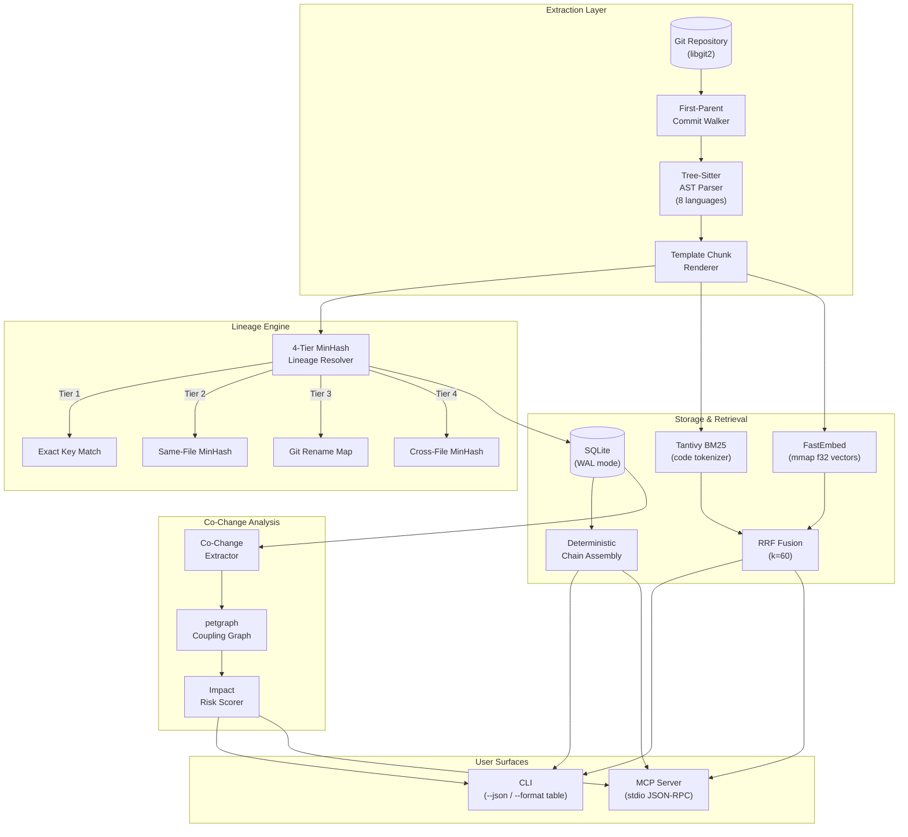

# gitctx — Git History Intelligence

[](https://github.com/pika-droid/gitctx/actions/workflows/ci.yml)

> **Deterministic, citation-backed Git history facts for LLMs and developers.** Zero network dependencies. Zero LLM calls. Pure offline indexing and retrieval.

`gitctx` is a local-first Rust tool that transforms Git history into a searchable, structured knowledge base. It tracks **why** code changed, **who** changed it, and **what** the historical coupling risks are — with complete function-level lineage tracking across renames and file moves.

---

## Key Features

| Feature | Description |
|---------|-------------|
| 🔍 **Natural-Language Search** | Query Git history with why-questions ("why was auth changed?") via template-rendered pseudo-documents |
| 🧬 **Function Lineage** | Track function identity across renames, moves, and refactors using multi-tier MinHash resolution |
| 📊 **Change Impact** | Statistical co-change coupling (support, confidence, lift) with time-decay weighting |
| 🤖 **MCP Server** | First-class Model Context Protocol integration for AI coding assistants |
| ⚡ **Fully Offline** | Zero network calls during indexing and retrieval (Invariant I1) |
| 🔒 **Deterministic** | Byte-identical outputs for identical inputs (Invariant I2) |

---

## Architecture



---

## Installation

### Prerequisites

- **Rust toolchain** (1.85+): Install via [rustup](https://rustup.rs/)
- **ONNX Runtime** (1.22.0): Required by the `fastembed` dense embedding engine. Download automatically:

```bash
# Download the correct ONNX Runtime shared library for your OS
cargo xtask download-ort-runtime

# The command prints the ORT_DYLIB_PATH — set it in your shell profile:
# Linux/macOS:
export ORT_DYLIB_PATH="$(pwd)/.ort/libonnxruntime.so.1.22.0"  # adjust for your OS

# Windows (PowerShell):
$env:ORT_DYLIB_PATH = "$PWD\.ort\onnxruntime.dll"
```

### Build from Source

```bash
git clone https://github.com/pika-droid/gitctx.git
cd gitctx

# Download ONNX Runtime for your platform
cargo xtask download-ort-runtime

# Build release binaries (produces `gitctx` and `gitctx-mcp`)
cargo build --release

# Verify installation
./target/release/gitctx --version
```

### Index a Repository

```bash
# Index the current repository
gitctx index .

# Index with verbose output
gitctx index . --verbose
```

### Search History

```bash
# Natural-language why-questions
gitctx search "why was the authentication flow changed?"

# Search with JSON output
gitctx search "connection pool timeout" --json
```

### Track Function Evolution

```bash
# Full chronological timeline of a function
gitctx evolution "process_request" --format table

# JSON output for programmatic use
gitctx evolution "handle_auth" --json
```

### Analyze Change Impact

```bash
# Co-change coupling analysis
gitctx impact src/auth.rs

# With risk scoring
gitctx impact src/database.rs --json
```

### MCP Server (AI Assistant Integration)

```bash
# Start the stdio MCP server
gitctx-mcp

# Or configure in your agent's MCP settings:
```

```json
{
  "mcpServers": {
    "gitctx": {
      "command": "gitctx-mcp",
      "args": []
    }
  }
}
```

**Available MCP Tools:**

| Tool | Purpose |
|------|---------|
| `search_history` | Search indexed Git history for functions, changes, and commits |
| `function_evolution` | Track complete evolutionary history of a function across renames/moves |
| `change_impact` | Analyze risk and co-change coupling for a file or function |
| `who_knows_this` | Find top contributors who modified a function or file |
| `commit_detail` | Show detailed commit info with all functions touched |

---

## CLI Commands

| Command | Description |
|---------|-------------|
| `gitctx index <path>` | Index a Git repository |
| `gitctx search <query>` | Search history with natural language |
| `gitctx evolution <function>` | Track function lineage timeline |
| `gitctx show <commit>` | Show detailed commit with function touches |
| `gitctx impact <path>` | Analyze co-change coupling and risk |
| `gitctx blame <function>` | Find who knows a function best |
| `gitctx doctor` | Diagnose index health and configuration |
| `gitctx init` | Generate agent configuration files |

All commands support `--json` for structured output and `--format table` for human-readable rendering.

---

## Project Invariants

These properties are mechanically enforced by the test suite and CI:

| ID | Invariant | Enforcement |
|----|-----------|-------------|
| **I1** | Zero network calls during index/search | `unshare -n` / mock network test |
| **I2** | Byte-identical outputs for identical inputs | Double-indexing SHA comparison |
| **I3** | Incremental ≡ full index equivalence | Incremental vs full state diff |
| **I4** | Non-null citation metadata on all results | Schema constraint + runtime check |
| **I5** | Isolated explain cache (opt-in only) | Separate SQLite table, off by default |
| **I6** | Pinned evaluation corpus | `eval/corpus.lock.toml` SHA lock |
| **I7** | Stated baselines & uncertainty | Bootstrap CIs on all reported metrics |
| **I8** | Explicit first-parent traversal | Git walker configuration + test |

---

## Performance Budgets

| Metric | Budget | Status |
|--------|--------|--------|
| Cold index (10k commits) | < 10 min | ✅ |
| Incremental index (1 commit) | < 2 sec | ✅ |
| Search p95 latency | < 300 ms | ✅ |
| MCP round-trip | < 500 ms | ✅ |
| Database size per 10k commits | < 100 MB | ✅ |

---

## Supported Languages

Tree-sitter historical parsing supports:

| Language | Grammar | Status |
|----------|---------|--------|
| Python | `tree-sitter-python` | ✅ |
| Rust | `tree-sitter-rust` | ✅ |
| JavaScript | `tree-sitter-javascript` | ✅ |
| TypeScript | `tree-sitter-typescript` | ✅ |
| Go | `tree-sitter-go` | ✅ |
| C | `tree-sitter-c` | ✅ |
| C++ | `tree-sitter-cpp` | ✅ |
| Java | `tree-sitter-java` | ✅ |
| PHP | `tree-sitter-php` | ✅ |

---

## Evaluation & Reproducibility

The evaluation suite is fully reproducible from pinned artifacts:

```bash
# Clone pinned evaluation corpus
cargo xtask clone-corpus

# Verify ground truth integrity (BLAKE3 + SHA-256)
cargo xtask verify-ground-truth

# Run lineage benchmark (M1-M10 synthetic mutations)
cargo xtask eval bench-lineage --format markdown

# Calibrate lineage thresholds
cargo xtask eval tune-thresholds

# Generate comprehensive evaluation report
cargo xtask eval report

# Run invariant and performance verification
cargo xtask test-invariants
cargo xtask bench
```

See [`eval/REPORT.md`](eval/REPORT.md) for the full evaluation report including ablation grid, lineage metrics, and failure taxonomy.

---

## Non-Goals

These are explicitly **not** in scope for gitctx:

- **LLM/Network dependencies during indexing or search** — The tool is 100% offline and deterministic by design.
- **Current-state code intelligence** — gitctx answers *why* code changed, not *what* the code does now. Use complementary tools (like codanna) for current-state analysis.
- **Cross-repository indexing** — Single repository workspace only.
- **Full dynamic dispatch resolution** — Python monkeypatching, duck typing, and dynamic dispatch are out of scope for lineage tracking.
- **Security vulnerability scanning** — Secret redaction is defense-in-depth only; no security guarantees.
- **Real-time file watching** — Deferred to potential future extensions.

---

## Workspace Structure

```
gitctx/
├── crates/
│   ├── gitctx-core/     # Git extraction, AST parsing, lineage engine
│   ├── gitctx-index/    # SQLite storage, Tantivy BM25, dense vectors
│   ├── gitctx-query/    # RRF fusion, co-change graph, impact analysis
│   ├── gitctx-cli/      # CLI commands and human output formatters
│   ├── gitctx-mcp/      # Stdio MCP server (JSON-RPC)
│   └── gitctx-eval/     # Synthetic mutations, benchmarks, report generator
├── xtask/               # Development task automation
├── eval/                # Evaluation artifacts, corpus, ground truth
├── tests/               # Integration and fixture tests
└── reference_repos/     # Vetted reference implementations (git-ignored)
```

---

## Development

```bash
# Run all checks (format, lint, test)
cargo xtask lint
cargo test --workspace

# Run invariant verification suite
cargo xtask test-invariants

# Run performance benchmarks
cargo xtask bench

# Clone reference repositories
cargo xtask clone-references

# Generate test fixtures
cargo xtask fixtures
```

---

## Troubleshooting

| Issue | Solution |
|-------|----------|
| `ORT_DYLIB_PATH` not set / ONNX Runtime not found | Run `cargo xtask download-ort-runtime` and set the `ORT_DYLIB_PATH` env var in your shell profile |
| `Index database not found` | Run `gitctx index .` in your repository root first |
| `Index is stale` (MCP warning) | Re-run `gitctx index .` to pick up new commits since last indexing |
| `Config hash mismatch` | Delete `.gitctx/` and re-index — the index config has changed |
| `parse_status = 'degraded'` on some files | Expected — tree-sitter couldn't parse those historical blobs (syntax errors, unsupported language). Function-level data falls back to file-level chunks |
| Slow first index | Cold indexing downloads the embedding model (~133 MB) on first run. Subsequent runs use the local cache |

---

## License

Licensed under either of:

- Apache License, Version 2.0 ([LICENSE-APACHE](LICENSE-APACHE) or <http://www.apache.org/licenses/LICENSE-2.0>)
- MIT License ([LICENSE-MIT](LICENSE-MIT) or <http://opensource.org/licenses/MIT>)

at your option.
